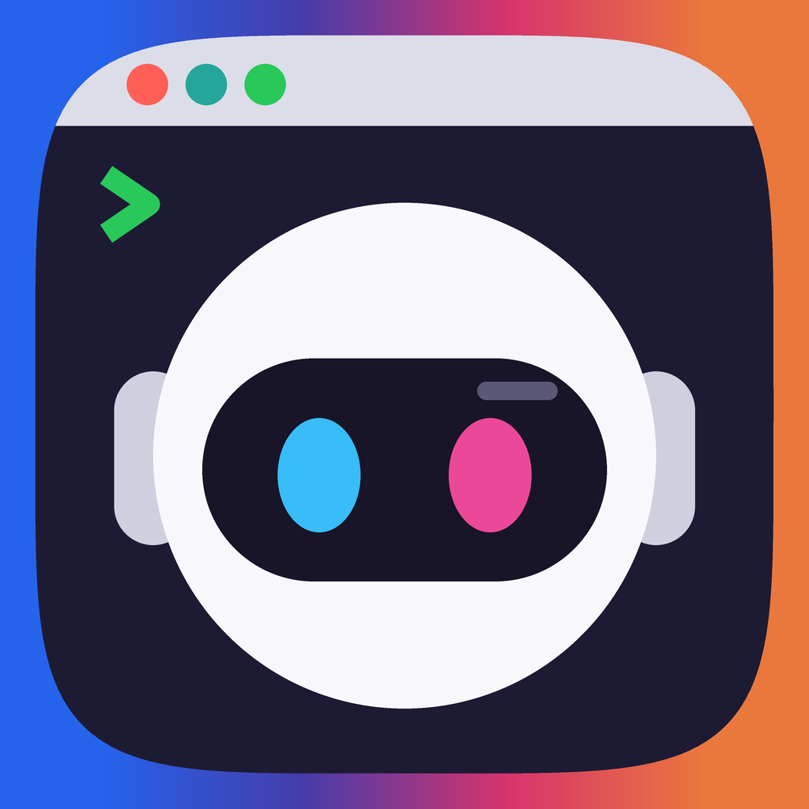

<h1>
  
  Universal Agent Manager
</h1>

UAM brings AI CLI runtimes into one desktop application on macOS and Windows, with persistent conversations, native terminals, shared configuration and optional SSH execution. It integrates Gemini CLI, Codex CLI, Claude Code CLI, OpenCode CLI, GitHub Copilot CLI and Antigravity CLI. The recorded Antigravity release scope is terminal only; structured support claims remain [under review](docs/documentation-review.md#antigravity-scope).

## Start here

- [Feature guide](docs/README.md): what features mean and how they should behave.
- [Provider requirements and checklists](docs/providers/providers.md): shared expectations, UAM equivalents and explicit gaps.
- [Architecture](docs/architecture.md): high-level system connections.
- [Building UAM](docs/building.md): development, packaging and test commands.
- [Build flags](docs/build-flags.md): deliberate exclusion of providers and policy-sensitive capabilities.

## Quick start

1. Download the relevant macOS or Windows package from [GitHub Releases](https://github.com/davidtaylor6130/Universal-Agent-Manager/releases).
2. Install and authenticate at least one included provider CLI.
3. Open UAM, select a workspace and choose the chat’s provider, model and permissions.

Build profiles may exclude providers, SSH, phone access or computer use. A provider launching successfully does not mean every shared feature is implemented; consult its checklist. Native terminal approvals remain controlled by that CLI.

## Product areas

| Area | Agreement |
|---|---|
| Conversations and layout | [Chat](docs/chat/chat.md), [Sidebar](docs/sidebar/sidebar.md) |
| Shared resources | [Central Setup](docs/settings/central-setup/central-setup.md), [Memory](docs/memory/memory.md) |
| Local and remote work | [Workspaces](docs/workspaces/workspaces.md), [Execution environments](docs/remote-environments/remote-environments.md) |
| Optional controls | [Computer use](docs/computer-use.md), [Phone browser access](docs/phone-access.md) |
| Interface consistency | [UI design language](docs/ui/design-language.md) |

UAM stores its own history and settings locally. Provider CLIs and configured transcription services may send supplied data to their services. Optional phone access is a browser interface published by the main device, not an installed phone application or UAM cloud backend. See [security and managed deployment](docs/security-enterprise.md) for the boundaries.

## Working on UAM

Read [AGENTS.md](AGENTS.md) and [the documentation rules](docs/documentation-rules.md) before changing behaviour. Find the owning feature page and applicable UI rules; keep affected agreements, provider checklist rows and the [V5 change log](<V5 Improvement Change log.md>) aligned in the same commit. This applies even when the human has not explicitly requested documentation. Preserve implementation gaps and pending acceptance rather than changing expectations to match a defect.

Run `python3 scripts/check_docs.py` before committing documentation or provider-capability changes. Use the existing application checks appropriate to an implementation change; documentation checks do not establish runtime correctness. [Engineering reference](docs/reference/README.md) retains useful source details, while [Documentation review](docs/documentation-review.md) records resolved contradictions and decisions still needed.

The supported desktop platforms are macOS and Windows; packaged SSH helper targets are Linux x86-64, Linux ARM64 and Windows x86-64. RAG engines, local model engines, templates, Dear ImGui, dedicated VCS panels and checked-in frontend build output remain outside this release slice.

## License

[MIT](LICENSE).
